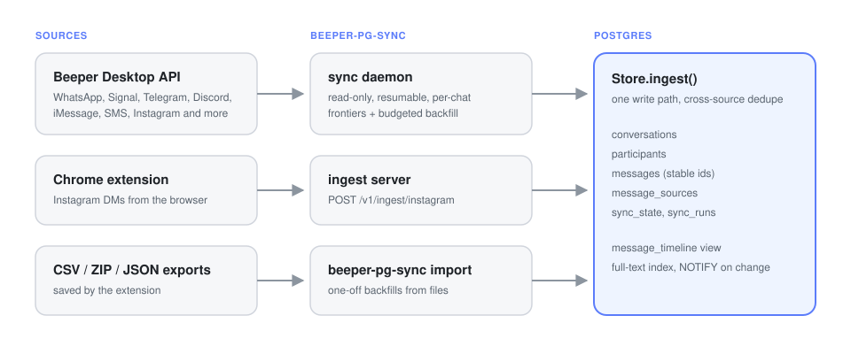

# The sync layer

inbox-recall is built on [beeper-pg-sync](https://github.com/joey12725/beeper-pg-sync), which is included here unchanged as the `beeper_pg_sync` package and the `beeper-pg-sync` command. It fills the database that inbox-recall searches.

<p align="center"></p>

## Beeper

[Beeper](https://www.beeper.com/) bridges WhatsApp, Signal, Telegram, Discord, iMessage, Google Messages, Instagram, Messenger, Slack, LinkedIn and more into one app, and Beeper Desktop exposes a local API. beeper-pg-sync reads it:

- **Strictly read-only.** The client only calls an allowlist of GET endpoints. It never sends, reacts, marks anything read or downloads media, and it drops attachment URLs before they reach the database.
- **Incremental and resumable.** Each chat keeps its own frontier and backfill cursor. Unchanged chats cost zero message requests, new messages arrive in seconds, and old history fills in a few pages per chat per run so one giant group never hogs a sync.

```bash
uv run beeper-pg-sync migrate    # inbox-recall migrate also does this
uv run beeper-pg-sync sync       # one sync
uv run beeper-pg-sync run        # daemon: sync every SYNC_INTERVAL seconds + extension ingest server
uv run beeper-pg-sync status
```

To get a token: in Beeper Desktop open Settings → Integrations, make sure the Desktop API is enabled, click **+** next to **Approved connections** and copy the token it creates.

## The Chrome extension

<p align="center"></p>

The extension lives in [`extension/`](../extension) and works on its own as an Instagram DM exporter, with sync on top.

1. Open `chrome://extensions`, turn on **Developer mode**, click **Load unpacked** and pick the `extension/` folder (or the folder from a release ZIP).
2. Open the extension's **Details → Extension options**. Enter your server URL (`http://127.0.0.1:8765` by default) and the `INGEST_TOKEN` from `.env`. **Test connection** confirms it.
3. Open [Instagram DMs](https://www.instagram.com/direct/inbox/) in English and click **Export**.

Pick a range (from a selected message, the N messages before one, or the whole conversation), then **Prepare export** and choose:

| Button | What you get |
| --- | --- |
| **Copy** | `speaker: message` lines on the clipboard |
| **Markdown** | a `.md` transcript with timestamps |
| **CSV** | `speaker, username, message, reactions, time, replying to, native_id, sender_id, direction, reply_id, timestamp_ms, time_precision` with formula-injection protection |
| **Sync** | the chat sent to your beeper-pg-sync server |

**Export all chats** walks Primary, General and Requests, saves a ZIP of per-chat CSVs with a coverage report, and can send each chat to the server as it goes. Files the extension saved earlier import with `uv run beeper-pg-sync import instagram-chats.zip`.

The extension runs locally. Its only network traffic is the server URL you configure. Instagram can mark chats as read when they're opened, so bulk export opens them one at a time and keeps the report honest about what it reached.

## How it works

**Beeper sync.** For each chat, `sync` compares Beeper's `lastActivity` with the last complete run and skips untouched chats outright. Otherwise it pages backwards from the newest message until it reaches the stored frontier, then spends up to `BEEPER_PAGES_PER_CHAT` pages continuing older history from a saved cursor. Every page is written in its own transaction, so an interrupted run loses nothing and the next one picks up where it stopped.

**One write path.** Sources never touch SQL. They produce `Batch` objects (a conversation plus messages) and `Store.ingest()` does the rest: upserting accounts and participants, resolving the conversation, matching messages already seen by another source, linking replies and emitting a `NOTIFY`.

**Dedupe rules.** Re-ingesting an observation updates it in place. A message from a second source merges into an existing row only when direction, a time window and a formatting-insensitive body comparison all point to exactly one candidate. Only the source that created a row rewrites its content; other sources fill gaps, such as a missing sender or a more precise timestamp.

## Schema at a glance

| Table | Holds |
| --- | --- |
| `accounts` | connected accounts per source (Beeper account IDs, bridge type) |
| `conversations` | one row per chat, unique on `(network, native_id)` when known |
| `conversation_sources` | which source IDs map to each conversation, and how they were linked |
| `participants` | people per network, with display names and handles |
| `messages` | the canonical message rows: body, sender, direction, timestamps, reactions, attachment metadata |
| `message_sources` | every source observation of every message, with its raw metadata |
| `sync_state`, `sync_runs` | resumable per-chat positions and a run log |
| `embedding_models`, `message_embeddings` | inbox-recall: registered models and one vector per message per model |

## Pulling upstream changes

The sync code tracks beeper-pg-sync. To bring in upstream fixes:

```bash
git remote add upstream https://github.com/joey12725/beeper-pg-sync.git
git fetch upstream && git merge upstream/main
```

inbox-recall's own migrations start at `1000`, so they never collide with core migrations.
